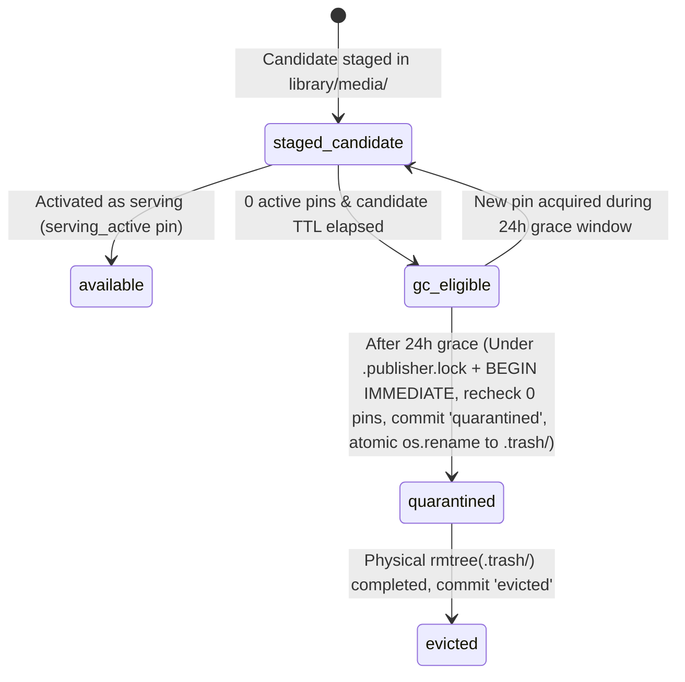

# Review cut — design for issue #77

- **Status**: Approved; implemented in unreleased component PRs. See [implementation status and exact contracts](CUT-REVIEW-IMPLEMENTATION.md). Antigravity draft, revised after coordinator review and final corrections. Endpoint/schema additions below remain proposed until their owning component implements and verifies them; this document does not deploy them.
- **Examples**: All example recordings, court labels, times, hashes and identifiers are synthetic.
- **Target Issue**: [`haocs/tennis-web#77` — review cut](https://github.com/haocs/tennis-web/issues/77)
- **Reviewed Baselines**:
  - `tennis-web`: `v0.18.0` (`a1d03cf7dc28e737fdca9cac34383bfff5ddd3b7`)
  - `courtside`: `main` (including PR #2 documentation updates)
  - `tennis-processing-server`: `3db34a89676a174d72cf68d8b455203785d6fa44`
  - `tennis-processing`: `810690b29df1826f5f144fd8c0882f7938155281`
  - `tennis-algorithm-lab`: `7ee67d82d4a21d3ce14965278e92414f0c777d22`

---

## 0. Summary of Revisions from Coordinator Review (v1 -> v2)

1. **Review Evidence vs. Editing Commands (`§6`)**:
   - Human `cut_feedback` and `processing_label` records are **immutable version-bound review evidence**, never automatic editing commands.
   - A `good_cut` verdict records positive assessment of that clip in that version; it is **not** an automatic `must_keep` constraint. Legacy boundary/issue records without an explicit verdict retain `verdict: null` (`unspecified`), never coerced to `poor_cut`.
   - `wrong_player` and `too_short` are distinct from `no_play` and never auto-map to exclusion masks.
   - Output-bound judgments never carry over automatically across reruns. Creating a constraint-guided rerun requires **two explicit operator steps**: (1) selecting specific version-bound review revisions, and (2) reviewing and confirming exact `keep_intervals_ms`, `exclude_intervals_ms`, or `override_clip_bounds_ms` in a **Constraint Preview** before submission.
   - Direction-only feedback (`start_early`, `end_late`, `downtime` without explicit timestamps) remains a non-binding suggestion/experiment hint. Overlapping or contradictory constraints are **rejected (`422 contradictory_constraints`)** for human resolution rather than masked by a `human_constraint_wins` rule.
2. **Actual Identities, Existing vs. Proposed Contracts, and Worker Capability Gating (`§2`, `§8`, `§10`)**:
   - Explicitly distinguishes `tennis-web` `video_id` (`source_sha256`, 64-hex) from `tennis-processing-server` `source_id` (`sources.id`, opaque UUID for a registered file generation).
   - Preserves existing `video_version_id = output_version(source_sha256, published_at)` (`v_<32-hex>`) immutably across candidate staging and publication: because `metadata_for_session` sets `published_at` during worker `package_result` and `files.activate()` preserves `published_at` verbatim when writing `library/metadata/sessions/<source_sha256>.json`, a candidate's `video_version_id` and its `attempt_id` mapping never change upon activation.
   - Uses the actual worker stage graph (`acquire_source -> verify_source -> prepare_proxy -> analyze -> process -> package_result -> upload_result`) and marks all new endpoints, tables, and `cut-constraints-v1` worker capabilities as **`[PROPOSED]`**. Un-upgraded `process-v2` workers cannot claim tasks requiring `cut-constraints-v1`. `dryrun` retains strict local-only media semantics.
3. **Authoritative NAS Orchestrator (`tennis-processing-server`) & Portable Snapshot Artifacts (`§6.3`, `§8`)**:
   - `tennis-processing-server` is the single authoritative owner of tasks, attempts, candidate staging, retention pins, and GC. `tennis-web` owns only viewing/review UI state and a bounded request proxy/outbox—never a second scheduler or independent pin authority.
   - Replaces bare website annotation IDs with a **server-owned immutable `feedback-snapshot` JSON artifact** (`snapshots/<source_sha256>/<snapshot_sha256>.json` in `processing` storage) containing full embedded revision contents, SHA-256 digest, source/attempt provenance, and confirmed editing commands, referenced in task specs via `{storage_id, path, sha256, bytes}`.
   - No blind background auto-submission of stale rerun or activation intents when the server is offline.
4. **Per-Reference Retention Pins & Race-Safe Two-Phase Quarantine GC (`§9`)**:
   - Replaces boolean pin flags with server-owned **per-reference pin rows** (`PRIMARY KEY (target_type, target_id, holder_kind, holder_id)`), separating short-lived UI comparison leases (`comparison_session`) from durable references (`saved_comparison`, `feedback_snapshot`, `serving_active`, `rollback_previous`, `operator_manual`). Closing one browser tab never releases another visitor's or saved comparison's pin.
   - Eliminates the DB-check-then-filesystem-delete TOCTOU race via a **fenced state machine (`available -> gc_eligible -> quarantined -> evicted`)**: under `.publisher.lock` and `BEGIN IMMEDIATE`, GC re-verifies zero pins, commits `media_state = 'quarantined'` (which fences off any new pin or activation with `409 media_already_evicted`), atomically renames the directory into same-filesystem `.trash/<attempt_id>`, unlinks outside the DB lock, and records `evicted`.
   - Clarifies that `14d`/`30d` TTLs are **`[PROPOSED]`** policies; active serving versions are permanent, and superseded serving outputs remain retained by default unless an explicit rollback-expiry policy is enabled.
5. **Safe Historical, Candidate, and Gap Media Access (`§2.3`, `§8.3`)**:
   - Distinguishes four explicit media states: `available` (in `library/media/<attempt_id>`), `staged_candidate` (verified `process` candidate staged read-only in `library/media/<attempt_id>` + `library/metadata/candidates/<source_sha256>/<attempt_id>.json` without activating `sessions/<source_sha256>.json`), `evicted` (media deleted after unpin, JSON manifest retained), and `never_rendered` (`dryrun` / analysis-only).
   - Corrects the privacy analysis of removed gaps: **an original recording's removed gaps contain unpublished footage that was cut before publication**. Issue `#77` therefore does **not** expose full-original proxies on the shared website; cut review and A/B comparison use retained clip media plus original-time interval metadata, while any future bounded gap-context proxy (`[PROPOSED]`) is strictly limited to the requested span + bounded context behind an explicit operator disclosure gate.
6. **Timebase Quantization, Authoritative Joined Offsets, and Mobile Single-Decoder Playback (`§3`)**:
   - Treats manifest `playback_start_seconds`, `playback_end_seconds`, and `clip.duration_seconds` as authoritative; never recomputes joined offsets by summing original intervals or promises `1 ms` seek resolution across VFR/frame-quantized H.264/HEVC media.
   - Handles $t_{\text{orig}} == D$, empty `0`-clip candidate outputs, touching clips ($e_i == s_{i+1}$), leading/trailing boundary alignment, and `RETAINED_MEDIA_UNAVAILABLE` vs. `REMOVED_GAP`.
   - Replaces follower seek loops with discrete transition synchronization gated by `readyState >= 2`, `seekEpoch` fencing, supported `playbackRate` checks, single-audible-player enforcement, and a **single `<video>` decoder on mobile** with user-gesture fallback.
7. **Heuristic Validity, Complete Cache Key, and Fixed Examples (`§5`)**:
   - Renames `likely_clean` to **`no_detector_warnings`** (meaning only that no heuristic rule fired, **not** verified cut quality). Absence/loss of person track is never treated as automatic `no_play` or trim truth; multiple people without identity lock yield `ambiguous_multiple_persons`; occlusion/poor view yields `unknown`.
   - Defines the full observation/heuristic cache key: `source_sha256` + proxy transform/FPS/color/PTS-map + detector model SHA-256/backend/input-size + extractor code digest + ROI/threshold config.
   - Fixes the v1 JSON/wireframe bug where hint `[340000, 365000)` lay outside gap `[208900, 333900)` (now `[240000, 265000)` = `04:00.0–04:25.0` inside `03:28.9–05:33.9` everywhere) and fixes the `"mapped_reasons"` key typo. Enforces strict parent-interval bounds checks and cursor pagination / storage references instead of silent `64 KiB` truncation.
8. **Processing Room Navigation Ownership with `TENNIS_PROCESSING_ROOM_URL` (`§4.1`)**:
   - Respects configured installations where `TENNIS_PROCESSING_ROOM_URL` points to the external `tennis-processing-server` portal (`templates/index.html`).
   - `tennis-web` owns the media-backed review surfaces at `/review/<source_sha256>/cuts` and `/review/<source_sha256>/compare` (with `/processing` providing a recording launcher when local and an explicit **`Open Processing Server Portal ↗`** handoff when external), plus proposed deep-links back from `tennis-processing-server` task details to `tennis-web`.

---

## 1. Executive Summary & Architectural Positioning

Issue [`#77`](https://github.com/haocs/tennis-web/issues/77) upgrades Courtside's cut reporting into an end-to-end **Cut Review, Heuristic Assistance, Feedback-Guided Reprocessing, and Pinned Version Comparison** workflow:

1. **Review Cut Surface & Serving-Version Default**:
   - Changes user-facing copy from **"Report this cut" / "Cut report"** to **"Review cut" / "Cut review"**.
   - Anchors cut review by default to the **currently serving `Video version`** on the website (`videos.current_version_id` / active `published_at` in `library/metadata/sessions/<source_sha256>.json`), while allowing read-only inspection (or explicitly version-scoped review) of historical or staged candidate versions.
2. **Optional Heuristic Assistance (Strict Compute & Epistemic Boundaries)**:
   - Surfaces worker-computed heuristic summaries (`heuristic-diagnostics.json`) and optional desktop browser-local `AutoFocusCore` diagnostics to highlight intervals where the primary person track disappeared, multiple people were ambiguous, or extended low-motion spans occurred near clip boundaries.
   - **Epistemic Invariant**: Person presence and motion are **heuristics**, not tennis-play or swing truth. `no_detector_warnings` means only that no heuristic rule fired, not that a cut is verified good. Heuristics never auto-create annotations or editing commands.
   - **Compute Invariant**: Batch/full-video heuristic extraction runs on **independent `tennis-processing` workers**, never on the NAS `tennis-web` or `tennis-processing-server` containers.
3. **Two-Step Evidence-to-Constraint Reprocessing Workflow**:
   - Separates **recording human review evidence** (`cut_feedback` / `processing_label`) from **issuing reprocessing editing commands**.
   - To reprocess with feedback, an operator explicitly selects version-bound review revisions, inspects and edits a **Constraint Preview** (`keep_intervals_ms`, `exclude_intervals_ms`, `override_clip_bounds_ms`), resolves any overlapping contradictions, and submits a **portable, server-persisted `feedback-snapshot` artifact** to `tennis-processing-server` (`POST /api/v1/tasks/{id}/rerun` with `publication_policy: "never"` and capability gate `cut-constraints-v1`).
4. **Comparing Two Pinned Versions (`A/B Version Comparison`)**:
   - Projects two pinned versions (`Version A` baseline/serving and `Version B` staged candidate or historical version) onto the canonical **Original Recording Timeline** (`[0, D_ms)`), decomposing the timeline into `BOTH_RETAINED`, `ONLY_A_RETAINED`, `ONLY_B_RETAINED`, and `BOTH_REMOVED`.
   - Provides synchronized dual-player playback on desktop (`1280px`) and a single-decoder **Instant A/B Deck Switcher** on mobile (`390px`/`320px`).
   - Saves a **Version Comparison Preference** record without automatically activating the preferred version for serving or promoting it to benchmark ground truth.

---

## 2. Actual vs. Proposed Identities, Contracts, and Storage Boundaries

### 2.1 Exact Identity Model Across Repositories

A central requirement is distinguishing identities that **already exist in code today** from extensions **proposed for `#77`**:

| Concept | Existing vs. Proposed | Exact Identifier & Format | Where Stored / Authoritative Owner | Critical Distinctions & Invariants |
| --- | --- | --- | --- | --- |
| **Original Content Digest** (`source_sha256`) | **Existing** | 64 lowercase hex chars (`[a-f0-9]{64}`) | Computed in `tennis-processing` (`verify_source`); used as session `id` in `library/metadata/sessions/<sha256>.json` | Content identity of the raw recording bytes. |
| **Website `video_id`** (route `<source>` / `<identity>`) | **Existing** | Equals `source_sha256` (`[a-f0-9]{64}`) | `tennis-web`: `videos.id` and `original_recordings.id` in `website.sqlite3`; `annotations.source_id` in `annotations.sqlite3` | **Not interchangeable with `tennis-processing-server` `source_id`!** |
| **Processing Server `source_id`** | **Existing** | 32-hex UUID (`uid()`) | `tennis-processing-server`: `sources.id` in `processing.sqlite3` | Identifies a registered file reference `{storage_id: "originals", path, bytes, modified_ns, sha256?}`. Linked to `source_sha256` via `json_extract(sources.body, '$.sha256')` after verification. |
| **Processing Server `task_id` & `attempt_id`** | **Existing** | 32-hex UUIDs (`uid()`) | `tennis-processing-server`: `tasks.id`, `attempts.id`, `publications.attempt_id` in `processing.sqlite3` | Authoritative execution identities. When activated, `files.activate()` sets `media_directory = attempt_id` and `artifact_directory = attempt_id`. |
| **Website `video_version_id`** | **Existing** | `v_<32-hex>` = `'v_' + sha256(json.dumps([source_sha256, float(published_at)], separators=(',', ':')).encode()).hexdigest()[:32]` | `tennis-web`: `video_versions.id` and `videos.current_version_id` in `website.sqlite3` (`entity_model.py`) | Derived from `[source_sha256, float(published_at)]`. **Must never change once created.** |
| **Website `clip_entity_id`** | **Existing** | `c_<32-hex>` = `'c_' + sha256((video_version_id + ':' + clip_id).encode()).hexdigest()[:32]` | `tennis-web`: `clips.id` in `website.sqlite3` | Binds boundary-derived `clip_id` (`[a-f0-9]{24}`) to a specific `video_version_id`. |
| **Candidate->Published Version Identity Mapping** | **`[PROPOSED]`** | `attempt_id` (32-hex) $\leftrightarrow$ `video_version_id` (`v_<32-hex>`) | `tennis-processing-server` `attempts` + `tennis-web` `video_versions` | Worker `package_result` freezes `session.published_at` inside `result.json` before completion (`attempt_id`). Because `files.activate()` preserves `session.published_at` verbatim when publishing `sessions/<source_sha256>.json`, `output_version(source_sha256, published_at)` is **identical** while staged as a candidate and after activation as serving! |
| **Feedback Snapshot ID** (`snapshot_id`) | **`[PROPOSED]`** | `fbs_<32-hex>` + `snapshot_sha256` (`[a-f0-9]{64}`) | `tennis-processing-server`: `feedback_snapshots` table + `processing` storage `snapshots/<source_sha256>/<sha256>.json` | Self-contained, immutable JSON bundle of selected human review revisions and operator-confirmed editing commands. |
| **Per-Reference Pin ID** | **`[PROPOSED]`** | Composite key `(target_type, target_id, holder_kind, holder_id)` | `tennis-processing-server`: `artifact_pins` in `processing.sqlite3` | Authoritative reference count/lease preventing GC eviction of `attempt_id` media. |

Candidate admission must verify that an existing `video_version_id` has the same source, frozen publication token and manifest digest. Reject a collision with different output contents; never overwrite or reinterpret an existing version. A candidate must be repackaged with a fresh generation before admission if necessary.

### 2.2 Candidate Staging & Historical Media Access Without Expanding Website Privileges

Today in `tennis-processing-server` ([files.py](https://github.com/haocs/tennis-processing-server/blob/3db34a89676a174d72cf68d8b455203785d6fa44/files.py)), when a worker completes a `process` task (`attempt_id`), its outputs live in `processing` storage at `runs/<task_id>/<attempt_id>/media/...` and `runs/<task_id>/<attempt_id>/metadata/...`. When `files.activate()` runs, it performs a same-filesystem `os.rename()` of `media` -> `library/media/<attempt_id>` and `metadata` -> `library/metadata/runs/<attempt_id>`, and atomically writes `library/metadata/sessions/<source_sha256>.json`.

Notice two crucial facts about `files.py` and `storage.py`:
1. **Superseded Serving Versions Already Have Media in `library/media/<old_attempt_id>`**:
   - When a newer attempt is activated, `files.activate()` updates `publications` and `library/metadata/sessions/<source_sha256>.json`, leaving `library/media/<old_attempt_id>/` and `library/metadata/runs/<old_attempt_id>/` intact inside `library/`.
   - And `tennis-web`'s `EntityCatalog.sync()` ([entity_model.py](https://github.com/haocs/tennis-web/blob/a1d03cf7dc28e737fdca9cac34383bfff5ddd3b7/entity_model.py)) already retains the old version's manifest (including `media_directory: "<old_attempt_id>"` and `clips[]`) in `website.sqlite3`'s `video_versions` table!
   - However, `tennis-web`'s existing `/media/<identity>/<filename>` route only calls `library.get(identity)` (which reads the active `sessions/<source_sha256>.json`).
2. **Unactivated Candidate `process` Runs Are in `processing/runs/<task_id>/<attempt_id>`**:
   - `tennis-web` does **not** mount `processing/` or `originals/`, and **must never** be given write access or raw `originals/` / `processing/` mounts.
   - How can `tennis-web` play and compare a completed candidate `process` version before it is activated as the serving session?
   - **`[PROPOSED]` Server-Validated Candidate Staging into `library/`**:
     - Recall that `files.py` already requires `processing` and `library` to reside on the same filesystem (`source_media.stat().st_dev == media.parent.stat().st_dev`), and `files.py` already checks `if not media.exists(): os.rename(source_media, media)`.
     - We propose `POST /api/v1/tasks/{task_id}/stage-candidate` (an explicit operator action; `publication_policy: "never"` alone does not authorize exposing an experiment to shared-site visitors):
       1. The operator is told that staging makes this selected candidate's retained footage visible to the shared website audience. `tennis-processing-server` validates `runs/<task_id>/<attempt_id>/result.json` using existing `files.validate_result()` and an idempotent staging intent. This does not expose every experiment automatically.
       2. Under `.publisher.lock`, `tennis-processing-server` moves `runs/<task_id>/<attempt_id>/media` -> `library/media/<attempt_id>` and `metadata` -> `library/metadata/runs/<attempt_id>`, and writes an allowlisted candidate manifest to **`library/metadata/candidates/<source_sha256>/<attempt_id>.json`** (containing `dict(data['session'], media_directory=attempt_id, artifact_directory=attempt_id, candidate_state='staged', processing={'task_id': task_id, 'attempt_id': attempt_id})`).
       3. Crucially, `library/metadata/sessions/<source_sha256>.json` is **not** modified, so the serving website library is completely untouched!
       4. If the operator later activates `task_id` via `POST /api/v1/tasks/{task_id}/activate`, `files.activate()` sees `library/media/<attempt_id>` and `library/metadata/runs/<attempt_id>` already exist in place and atomically promotes the manifest to `library/metadata/sessions/<source_sha256>.json`!

### 2.3 Four Explicit Media Availability States (`media_state`)

Every version descriptor returned to the UI carries an explicit `media_state`:

| `media_state` | Meaning | Playback & Timeline Behavior in UI |
| --- | --- | --- |
| **`available`** | Serving or historical version whose verified MP4 files (`Practice.mp4`, `Clips/clip-NNN.mp4`) are present in `library/media/<media_directory>`. | Full video playback, scrubbing, and timeline comparison available via `/media/versions/<video_version_id>/<filename>`. |
| **`staged_candidate`** | Unactivated `process` attempt staged by `tennis-processing-server` into `library/media/<attempt_id>` + `library/metadata/candidates/<source_sha256>/<attempt_id>.json`. | Full video playback and A/B comparison available in the Review Cut / Compare views; clearly badged **`CANDIDATE (Not serving)`**. |
| **`evicted`** | Media files were previously rendered but later garbage-collected after all retention pins were released; compact manifest in `video_versions` / `tasks.result` remains. | Timeline bars, delta decomposition, and boundary statistics render 100% from the retained manifest. Video player displays **`Kept in Version B, but video media expired`** (never mislabeled as a cut gap!). |
| **`never_rendered`** | Run was a `dryrun` (local scratch media only, no NAS media upload) or an analysis-only `experiment` that produced clip intervals without MP4s. | Timeline bars and delta decomposition render from the interval list; player displays **`Interval-only run (dry-run / no rendered video on NAS)`**. |

### 2.4 Privacy Boundary for Removed Gaps (No Expansion of Shared-Site Access to Private Originals)

- **Why Full-Original Review Proxies Must Not Be Auto-Exposed on `tennis-web`**:
  - The intervals removed by the processor ($\mathcal{G}_V$) contain footage that was **intentionally excluded from the published session** (e.g., sideline conversations, checking phones, walking past the camera, or idle court time).
  - Serving a full-original proxy to all shared-site visitors would expose previously private, unpublished footage—it is **not** "already-published footage".
- **Enforced Design Rule**:
  1. **`tennis-web` never mounts `originals/`**.
  2. **Default Gap Inspection in Issue `#77` Uses Metadata + Adjacent Retained Clip Edges Only**:
     - When inspecting a removed gap $[a_j, b_j)$, the reviewer sees the exact duration ($b_j - a_j$), the tail of the preceding retained clip $c_i$ (up to $a_j$), the head of the following retained clip $c_{i+1}$ (starting at $b_j$), any worker heuristic hints in $[a_j, b_j)$, and can flag a `missed_play` interval inside $[a_j, b_j)$ without streaming unpublished gap video.
  3. **Future Operator-Gated Bounded Gap Proxy (`[PROPOSED — Deferred / Operator-Disclosure Only]`)**:
     - If visual inspection inside a removed gap is needed later, it must **never** generate a whole-recording proxy by default.
     - Instead, an operator-initiated request must specify a **bounded span** (`[req_start_ms, req_end_ms]` within a single gap plus at most $\pm 5\text{s}$ context, capped at $\le 60\text{s}$ total), display an explicit privacy disclosure before queuing (`"This will render unpublished original footage from 04:00.0–04:25.0 into a temporary review clip visible on the LAN"`), and carry its own standalone manifest (`{proxy_id, source_sha256, original_start_ms, original_end_ms, duration_ms, pts_mapping, sha256, expires_at}`).

---

## 3. Timebase, Frame Quantization, and Synchronized Playback Engineering

### 3.1 Authoritative Manifest Clocks vs. Original Recording Clock

A published or staged session manifest has three distinct clocks that **must not be conflated**:
1. **Original Recording Clock (`original_ms` / `original_seconds`)**:
   - Canonical domain $[0, D]$ where $D = \text{round}(\text{source.duration\_seconds} \times 1000)$.
   - Each clip $c_i$ ($i \in \{1, \dots, N\}$) has authoritative original bounds $[s_i, e_i)$ where $s_i = \text{round}(c_i.\text{original\_start\_seconds} \times 1000)$ and $e_i = \text{round}(c_i.\text{original\_end\_seconds} \times 1000)$, satisfying $0 \le s_1 < e_1 \le s_2 < e_2 \le \dots < e_N \le D$.
2. **Encoded Individual Clip Clock (`local_seconds` $\in [0, d_i]$)**:
   - Each rendered clip file (`Clips/clip-NNN.mp4`) has an encoded duration $d_i = c_i.\text{duration\_seconds}$ (and browser `videoElement.duration` once `loadedmetadata` fires).
   - Because of video frame quantization ($1/\text{fps}$, e.g. $33.37\text{ ms}$ at $29.97\text{ fps}$ or $16.68\text{ ms}$ at $59.94\text{ fps}$), VFR source timestamps, and audio packet priming, $d_i$ can legitimately differ from $(e_i - s_i)/1000$ by a bounded number of frames (two frames are about $67\text{ ms}$ at 29.97 fps). The implementation must validate this tolerance from actual timestamps rather than assume a fixed 35 ms bound.
3. **Encoded Concatenated Full-Practice Clock (`playback_seconds` $\in [0, D_{\text{joined}}]$)**:
   - Each clip $c_i$ in `Practice.mp4` has **authoritative** chapter bounds $[p_i, q_i) = [c_i.\text{playback\_start\_seconds}, c_i.\text{playback\_end\_seconds})$ validated by `storage.py` (`previous < playback_start_seconds < playback_end_seconds <= video.duration_seconds + 0.1`).
   - **Rule**: Always use the manifest's authoritative $p_i, q_i, d_i$ (and runtime `videoElement.duration`) for seeking; **never** recompute $p_i$ by summing $(e_k - s_k)$!

### 3.2 Piecewise-Linear Time Projection & Edge Cases

For a version $V$ with clips $\mathcal{C}_V = \{c_1, \dots, c_N\}$ and original duration $D$:

- **Removed Gaps $\mathcal{G}_V$ Construction (Handling Leading, Trailing, Touching, and Empty Outputs)**:
  - If $N == 0$ (e.g., an empty candidate `dryrun` or `experiment` where all footage was removed):
    - $\mathcal{C}_V = \emptyset$, and $\mathcal{G}_V = \{g_0 = [0, D)\}$ (if $D > 0$).
  - If $N \ge 1$:
    - Emit leading gap $[0, s_1)$ **if and only if** $s_1 > 0$.
    - For $i = 1, \dots, N-1$: emit internal gap $[e_i, s_{i+1})$ **if and only if** $e_i < s_{i+1}$. If $e_i == s_{i+1}$ (**touching clips**, e.g. a rally split into two adjacent clips), emit **no** zero-length gap, and record $e_i$ as a `touching_clip_boundary`.
    - Emit trailing gap $[e_N, D)$ **if and only if** $e_N < D$.

- **Forward Projection $\pi_V(t_{\text{orig}})$ for $t_{\text{orig}} \in [0, D]$**:
  - **Endpoint Rule ($t_{\text{orig}} == D$)**:
    - For $t_{\text{orig}} < D$, clip membership uses half-open intervals $s_i \le t_{\text{orig}} < e_i$ and gap membership uses $a_j \le t_{\text{orig}} < b_j$.
    - At the exact right endpoint $t_{\text{orig}} == D$: if $N \ge 1$ and $e_N == D$, $t_{\text{orig}} = D$ maps to the end of the final clip $c_N$ (`local_sec = d_N`, `joined_sec = q_N`); otherwise ($N == 0$ or $e_N < D$), it maps to the end of the trailing gap $g_{\text{last}}$ (`gap_offset_ms = D - a_{\text{last}}`).
  - **Within a Retained Clip $c_i = [s_i, e_i)$**:
    - Let $\alpha = \text{clamp}\!\left(\frac{t_{\text{orig}} - s_i}{e_i - s_i}, 0, 1\right)$.
    - `local_sec` $= \alpha \cdot d_{\text{effective}, i}$, where $d_{\text{effective}, i} = \text{ videoElement.duration}$ if finite and $> 0$ (and within the validated encoder/frame-duration tolerance of $d_i$), else $d_i$.
    - `joined_sec` $= p_i + \alpha \cdot (q_i - p_i)$.
  - **Inverse Projection $\pi_V^{-1}(c_i, t_{\text{local}})$**:
    - Let $\beta = \text{clamp}\!\left(\frac{t_{\text{local}}}{d_{\text{effective}, i}}, 0, 1\right)$.
    - $t_{\text{orig}} = \text{round}\bigl(s_i + \beta \cdot (e_i - s_i)\bigr)$.
  - **Frame Quantization Tolerance**:
    - Seeking a browser `<video>` snaps to the nearest decoded frame timestamp. All UI playhead comparisons and automated tests use frame-quantized tolerance $\epsilon_{\text{frame}} = \max(45\text{ ms}, 2\lceil 1000 / \text{fps} \rceil)$ rather than assuming exact `1 ms` seek resolution.

### 3.3 Dual-Version (`A/B`) Elementary Decomposition & Compatibility Validation

Before comparing two versions $V_A$ and $V_B$:
1. **Source Compatibility Gate**:
   - Verify `V_A.source_sha256 == V_B.source_sha256` (the two `video_version_id` values remain distinct) and `abs(V_A.source.duration_seconds - V_B.source.duration_seconds) <= 0.05`. If violated, abort comparison with `422 incompatible_comparison_sources`.
   - Use $D = \text{round}(1000 \cdot \max(V_A.\text{source.duration_seconds}, V_B.\text{source.duration_seconds}))$ and clamp any minor sub-millisecond boundary float representation into $[0, D]$.
2. **Elementary Partition $\mathcal{U}$**:
   - Let $\mathcal{U} = \text{sort\_unique}\bigl(\{0, D\} \cup \bigcup_{c \in \mathcal{C}_{V_A}} \{s_c, e_c\} \cup \bigcup_{c \in \mathcal{C}_{V_B}} \{s_c, e_c\}\bigr) = \{u_0, u_1, \dots, u_K\}$.
   - Each elementary interval $I_k = [u_k, u_{k+1})$ ($u_k < u_{k+1}$) has a constant retention state:
     - **`BOTH_RETAINED`**: $I_k \subseteq \mathcal{C}_{V_A} \cap \mathcal{C}_{V_B}$
     - **`ONLY_A_RETAINED`**: $I_k \subseteq \mathcal{C}_{V_A} \setminus \mathcal{C}_{V_B}$
     - **`ONLY_B_RETAINED`**: $I_k \subseteq \mathcal{C}_{V_B} \setminus \mathcal{C}_{V_A}$
     - **`BOTH_REMOVED`**: $I_k \subseteq \mathcal{G}_{V_A} \cap \mathcal{G}_{V_B}$
3. **Distinguishing `REMOVED_GAP` from `RETAINED_MEDIA_UNAVAILABLE`**:
   - Each elementary span $I_k$ also carries `a_playable = (I_k in C_A) and (V_A.media_state in {'available', 'staged_candidate'})` and `b_playable = (I_k in C_B) and (V_B.media_state in {'available', 'staged_candidate'})`.
   - If $I_k \subseteq \mathcal{C}_{V_B}$ (`BOTH_RETAINED` or `ONLY_B_RETAINED`) but `V_B.media_state` is `evicted` or `never_rendered` (or a clip media request fails with `404`), Viewport B displays **`Retained in Version B (Clip B2 · 04:00.0–04:25.0) — Video media unavailable`**, **never** `"Cut in Version B"`.

### 3.4 Concrete Walkthrough Example (Consistent Across All Sections)

Let `source_sha256` have duration $D = 600{,}000\text{ ms}$ (`10:00.000`):
- **Version A (Serving `v_8f3a`, `attempt_a1`)**:
  - `Clip A1`: `[55000, 130400)` (`00:55.000–02:10.400`, `75.4s`)
  - `Clip A2`: `[145000, 208900)` (`02:25.000–03:28.900`, `63.9s`; includes `10.9s` of post-rally ball roll/towel walk `03:18.000–03:28.900`)
  - `Clip A3`: `[333900, 420000)` (`05:33.900–07:00.000`, `86.1s`)
  - Removed gaps in A: `Gap A_g0 = [0, 55000)`, `Gap A_g1 = [130400, 145000)`, **`Gap A_g2 = [208900, 333900)` (`03:28.900–05:33.900`, `125.0s`)**, `Gap A_g3 = [420000, 600000)`.
- **Version B (Candidate Rerun `v_c91d`, `attempt_b2`)**:
  - `Clip B1`: `[51000, 130400)` (`00:51.000–02:10.400`, `79.4s`; starts `4.0s` earlier)
  - `Clip B2`: `[145000, 198000)` (`02:25.000–03:18.000`, `53.0s`; tail trimmed by `10.9s`)
  - `Clip B3`: `[240000, 265000)` (`04:00.000–04:25.000`, `25.0s`; recovered rally inside `Gap A_g2`!)
  - `Clip B4`: `[333900, 420000)` (`05:33.900–07:00.000`, `86.1s`; matches `Clip A3`)

Elementary decomposition $\mathcal{U}$ produces **3 Disagreement Regions (Deltas)**:
- **Delta #1 (`[51000, 55000)`, `00:51.000–00:55.000`, `4.0s`)**: `ONLY_B_RETAINED` (`Clip B1` starts `4.0s` earlier than `Clip A1`).
- **Delta #2 (`[198000, 208900)`, `03:18.000–03:28.900`, `10.9s`)**: `ONLY_A_RETAINED` (`Clip A2` tail trimmed in `V_B`, lies in `Gap B_g2 = [198000, 240000)`).
- **Delta #3 (`[240000, 265000)`, `04:00.000–04:25.000`, `25.0s`)**: `ONLY_B_RETAINED` (New `Clip B3` recovered inside `V_A`'s removed `Gap A_g2 = [208900, 333900)`).

### 3.5 Desktop Dual-Player Synchronization & Mobile Single-Decoder Architecture

1. **Epoch-Fenced Discrete Synchronization (No Follower Seek Loops)**:
   - Maintain an integer `compareEpoch` incremented on every play, pause, scrub, delta jump, clip transition, or version change.
   - To seek/start at $t_{\text{orig}}$:
     - Increment `compareEpoch = ++epoch`.
     - Project $\pi_{V_A}(t_{\text{orig}})$ and $\pi_{V_B}(t_{\text{orig}})$.
     - For each playable side ($S \in \{A, B\}$) that is in a `retained` state:
       - Ensure `<video>` `src` is set to that clip's URL (`/media/versions/<v_id>/Clips/clip-NNN.mp4`).
       - Wait for `readyState >= 1` (`loadedmetadata`), set `currentTime = local_sec`, and wait for `seeked` / `readyState >= 2` while verifying `compareEpoch === epoch` (**Seek-Ready Gate**).
     - Only after all active playable viewports pass the Seek-Ready Gate under the same `epoch` does the controller call `.play()`.
   - **During Playback**:
     - Whichever viewport is currently playing a retained clip drives the UI readout $t_{\text{orig}} = \pi_{V_{\text{leader}}}^{-1}(c, \text{video.currentTime})$ via `requestAnimationFrame` / `timeupdate`.
     - In `BOTH_RETAINED`, **do not** seek the follower on every `timeupdate`! Both videos play natively at the same `playbackRate`. Only if $|\pi_{V_A}^{-1}(t_A) - \pi_{V_B}^{-1}(t_B)| > 250\text{ ms}$ for $> 1.0\text{s}$ (and neither video is `seeking` or `waiting`) issue a single coalesced resync under a new `compareEpoch`.
     - If either active video fires `waiting` (network/disk buffer stall), pause the peer video and show a `Buffering…` indicator until `canplay` resumes both.
     - If a video fires `error`, transition that viewport to an explicit error slate (`"Could not decode clip media [Retry]"`) and allow the remaining healthy viewport to continue operating independently.
2. **Playback Rate Validation & Single Audible Player**:
   - Allowed rates: `0.25`, `0.5`, `0.75`, `1`, `1.25`, `1.5`, `2`. Setting `playbackRate` validates finite membership, wraps assignment in `try/catch`, and falls back to `1.0` if unsupported by the browser's media engine.
   - **Audio Exclusivity**: `Player A` and `Player B` never unmute simultaneously. A radio group (`Audio: (*) Version A  ( ) Version B  ( ) Mute Both`) forces `muted = true` on the non-selected player before setting `muted = false` on the selected player.
3. **Mobile Single-Decoder Architecture (`390px` / `320px`)**:
   - On mobile (`matchMedia('(max-width: 650px), (pointer: coarse)')`), **only one `<video id="compare-mobile-player">` element exists in the DOM**.
   - The **Deck Switcher (`[ Viewing Version A | Switch to Version B ]`)** swaps the active side at the current $t_{\text{orig}}$ inside the user's `click` event handler (attempting playback within the gesture; asynchronous media loading may still require another explicit tap). If `video.play()` rejects with `NotAllowedError`, the player overlay surfaces an explicit `[Tap to play]` button rather than failing silently.

---

### 3.6 Gap traversal and playback failure rules

- **Active union (default):** play retained spans from either version. Across a span removed by both, jump to the next retained span and briefly show the skipped original duration. Stop at the end of the union.
- **Disagreements only:** visit only `ONLY_A_RETAINED` / `ONLY_B_RETAINED` regions, preserving exact boundaries; grouping nearby deltas changes navigation only, not which footage was retained.
- Manual scrubbing into a both-removed span pauses playback and shows gap slates. Adjacent retained boundary frames are context, never presented as footage from the removed span. There is no hidden full-original playback mode.
- If retained media is unavailable on every relevant side, pause with an explicit unavailable state. Do not advance a fake video clock. The user can still inspect metadata and jump to another delta.
- A rerender after eviction creates a new attempt/output identity. It cannot be relabeled as the original assessed bytes or silently inherit old output-specific judgments. A reference to the prior version records reconstruction provenance; existing reviews remain attached to the original version.

---

## 4. Processing Room Navigation Ownership & Concrete Wireframes

### 4.1 Navigation Ownership & `TENNIS_PROCESSING_ROOM_URL` Integration

In `tennis-web` ([app.py](https://github.com/haocs/tennis-web/blob/a1d03cf7dc28e737fdca9cac34383bfff5ddd3b7/app.py) line 38, [templates/index.html](https://github.com/haocs/tennis-web/blob/a1d03cf7dc28e737fdca9cac34383bfff5ddd3b7/templates/index.html) line 10), `TENNIS_PROCESSING_ROOM_URL` defaults to `"/processing"`, **or** in a multi-container deployment may be configured to point to the separate `tennis-processing-server` control portal (`templates/index.html` in `tennis-processing-server`, which manages Workers, Task History, and Input Watchers).

To ensure **Review Cut** and **Compare Versions** are always reachable without breaking or duplicating the `tennis-processing-server` portal:

1. **Canonical Shell Owner (`tennis-web`)**:
   - `tennis-web` is the canonical owner of the media-backed **Review Cut** (`/review/<source_sha256>/cuts`) and **Compare Versions** (`/review/<source_sha256>/compare`) views, because `tennis-web` owns the session/clip media streaming routes, clip posters, player roster, Moment/Annotation store, and `ReviewPlayer`.
   - Route aliases `/processing/cuts/<source_sha256>` and `/processing/compare/<source_sha256>` in `tennis-web` resolve to the exact same views.
2. **Preserving Top-Nav `Processing` (`#nav-processing`) Behavior**:
   - Top-nav `#nav-processing` continues to link to `{{ processing_url }}` (`TENNIS_PROCESSING_ROOM_URL`), and the Processing status dot retains its existing destination.
   - When the user is on `/review/<source_sha256>/cuts` or `/review/<source_sha256>/compare` in `tennis-web`:
     - `#nav-processing` is highlighted as active (`class="active"`).
     - The workspace header renders a 3-item Processing Room sub-navigation bar:
       - **`Review Cut`** (`/review/<source_sha256>/cuts`)
       - **`Compare Versions (A/B)`** (`/review/<source_sha256>/compare`)
       - **`Queue & Workers`** (links to `processing_url` — if `processing_url == "/processing"`, switches to the local status view; if `processing_url` is an external `tennis-processing-server` portal URL, renders **`Processing Server Portal ↗`** with `?source_sha256=<source_sha256>`).
3. **Entry Points**:
   - **From `/review/<source_sha256>` (Video/Clip Review)**:
     - Player `⋯` More menu item says **`Review cut`** (replacing `Review cuts`) and navigates to `/review/<source_sha256>/cuts?clip=<current_clip_id>`.
     - Each row in the `Timeline` table on `/review/<source_sha256>` includes a **`Review cut`** link for that clip or gap.
   - **From `tennis-processing-server` Portal (`[PROPOSED in tennis-processing-server]`)**:
     - When `website_url` is configured in `server.json`, the task detail modal (`#detail`) for any task with a known `source_sha256` displays **`Review cuts on website ↗`** (`<website_url>/review/<source_sha256>/cuts`) and **`Compare versions ↗`** (`<website_url>/review/<source_sha256>/compare?b=<attempt_id>`).
   - **From `tennis-web` `/processing` (when `TENNIS_PROCESSING_ROOM_URL == "/processing"`)**:
     - Displays the processor status panel plus a **Recording Cut Review & Comparison Launcher** listing published recordings with **`[Review cut]`** and **`[Compare versions]`** buttons.

### 4.2 Desktop Wireframe (`1280px`): Review Cut (Current-Serving Version Default)

```text
+----------------------------------------------------------------------------------------------------------------------+
| Courtside                                                    [ Library ]   [ Learning ]   [ *Processing (Green dot) ]|
+----------------------------------------------------------------------------------------------------------------------+
| Library / Morning Practice (Nov 7) / Processing Room · Review cut                                                    |
| [ *Review Cut (Serving) ]   [ Compare Versions (A/B) ]   [ Processing Server Portal ↗ ]    [ <- Back to Video Review ]|
+----------------------------------------------------------------------------------------------------------------------+
| Recording: [ Morning Practice — Court 3 (Nov 7)       v ]   Reviewed Version: [ *Serving (v_8f3a · Nov 7 10:14am) v ]|
| Version Status: ACTIVE SERVING VERSION · 3 clips · 3m 45.4s kept · 6m 14.6s removed · [ Compare with another run -> ]  |
+----------------------------------------------------------------------------------------------------------------------+
| ORIGINAL RECORDING TIMELINE (10:00.0 total · Click any clip or removed gap to inspect)                               |
| +------------------------------------------------------------------------------------------------------------------+ |
| | [Gap 0:55] |=== Clip 01 ===| [Gap 0:14] |=== Clip 02 (!) ===| [Gap 2:05 (03:28.9–05:33.9)] |=== Clip 03 ===| ... | |
| +------------------------------------------------------------------------------------------------------------------+ |
| Heuristic hints (worker track): [!] Clip 02: Person track lost 03:18.0–03:28.9 · [!] Gap 02: Motion 04:00.0–04:25.0  |
+-------------------------------------------------------------------+--------------------------------------------------+
| SELECTED TARGET: Clip 02 · Original 02:25.000–03:28.900 (1m 03.9s)| REVIEW THIS CUT (Clip 02 · Serving v_8f3a)       |
| +---------------------------------------------------------------+ |                                                  |
| |                                                               | | Cut Verdict (Optional — human evidence):         |
| |                     <VIDEO PLAYER: CLIP 02>                   | | (*) Unspecified      ( ) Good cut                |
| |                                                               | | ( ) Needs adjustment ( ) Poor cut                |
| |   [Optional Heuristic Hint Banner]                            | |                                                  |
| |   ! Heuristic hint: Person track lost 03:18.0–03:28.9         | | Issues observed (select at least one or verdict):|
| |     (Person/motion heuristic only — not play or swing truth)  | | [x] End too late       [ ] Start too early       |
| |     [ Jump to 03:18.0 ]   [ Prefill form fields ]             | | [ ] Start too late     [ ] End too early         |
| |                                                               | | [x] Lost player        [ ] No tennis play        |
| |  [ |< ] [ -0.5s ]  [ > Play ]  [ +0.5s ] [ >| ]  0:53 / 1:03.9| | [ ] Too much downtime  [ ] Too short             |
| |  |====================================*---------| [Auto]  1x  | | [ ] Wrong player                                 |
| +---------------------------------------------------------------+ |                                                  |
| Prev Gap: 02:10.4–02:25.0 (14.6s cut)   [Select gap to report]    | Suggested Original Bounds (Optional):            |
| Next Gap: 03:28.9–05:33.9 (2m 05.0s cut)[Select gap to report]    | Start (s): [ 145.000 ] [Use playhead] [-0.5][+0.5]|
|                                                                   | End (s):   [ 198.000 ] [Use playhead] [-0.5][+0.5]|
|                                                                   | Note: [ Ball roll and towel walk after 03:18   ] |
|                                                                   | [ Save cut review ]            [ Clear form ]    |
+-------------------------------------------------------------------+--------------------------------------------------+
| SAVED CUT REVIEWS ON v_8f3a (2 active)  [ ] Show archived         | PREPARE REPROCESS TASK (Explicit 2-Step Preview) |
| +---------------------------------------------------------------+ | Step 1: Select review revisions to include:      |
| | [x] Clip 02 (rev v2) · Needs adjustment · End late, Lost plyr | |  [x] Clip 02 (rev v2): Suggested end 03:18.000   |
| |     Suggested bounds: 02:25.000–03:18.000 · "Ball roll..."    | |  [x] Gap 03:28.9–05:33.9 (rev v1): 04:00.0–04:25.0|
| |     [Jump] [Edit] [Archive] [History]                         | | Step 2: Confirm exact editing commands:          |
| +---------------------------------------------------------------+ |  [x] Override Clip 02 bounds -> 02:25.0–03:18.0  |
| | [x] Gap 03:28.9–05:33.9 (rev v1) · Missed play                | |  [x] Must-keep interval      -> 04:00.0–04:25.0  |
| |     Interval: Original 04:00.000–04:25.000 (25.0s inside gap) | |  Validation: 0 overlapping conflicts.            |
| |     [Edit] [Archive] [History]                                | | Task Mode: [ Candidate Process (Never auto-pub)v]|
| +---------------------------------------------------------------+ | [ Submit Reprocess Task to Server ]              |
+-------------------------------------------------------------------+--------------------------------------------------+
```

### 4.3 Desktop Wireframe (`1280px`): Compare Two Pinned Versions (`A/B`)

```text
+----------------------------------------------------------------------------------------------------------------------+
| Library / Morning Practice (Nov 7) / Processing Room · Compare Versions                                              |
| [ Review Cut (Serving) ]   [ *Compare Versions (A/B) ]   [ Processing Server Portal ↗ ]   [ <- Back to Video Review ]|
+----------------------------------------------------------------------------------------------------------------------+
| Version A (Baseline):  [ *Serving: v_8f3a (Attempt a1 · 3 clips · 3m 45.4s kept · Media: Available) v ]              |
| Version B (Candidate): [ *Rerun #2: v_c91d (Attempt b2 · 4 clips · 4m 03.5s kept · Media: Staged Candidate) v ]      |
| Retention Pin Status:  Version A: Protected (Active Serving) · Version B: Pinned (Lease + Saved Comparison) [Unpin B]|
+----------------------------------------------------------------------------------------------------------------------+
| DELTA SUMMARY: Version B vs Version A (Same Source SHA-256 · Duration 10:00.000)                                     |
| • 3m 34.5s kept in both   • +29.0s Only in B (2 spans: +4.0s lead-in, +25.0s Clip B3)   • -10.9s Only in A (1 span)  |
| Playhead Mode: (*) Active Union (A U B)   ( ) Disagreements Only (3 deltas)                |
| [ |< Prev Delta ]   Delta 2 of 3: Original 03:18.000–03:28.900 (10.9s Only in A · Cut in B)        [ Next Delta >| ] |
+----------------------------------------------------------------------------------------------------------------------+
| ALIGNED ORIGINAL RECORDING TIMELINE (Master Clock: 03:21.400 / 10:00.000)                                            |
| Version A: |--Gap--|--Clip A1--|Gap|====== Clip A2 (02:25.0–03:28.9) ======|--- Gap A_g2 (03:28.9–05:33.9) ---|--A3--|
| Version B: |-Gap-|-Clip B1 (51s)|G |=== Clip B2 (02:25–03:18) ===|Gap B_g2 |=Clip B3 (04:00–04:25)=|--Gap B_g3|--B4--|
| Diff Band: [Cut ][B][ Both Kept][C ][        Both Kept           ][Only A  ][Cut][    Only in B    ][Both Cut ][Both ]
|                                                                       ^ Playhead (03:21.400)                         |
+-----------------------------------------------------------------+----------------------------------------------------+
| VERSION A · SERVING (v_8f3a) · Clip A2 (Local 0:56.4 / 1:03.9)  | VERSION B · CANDIDATE (v_c91d) · IN REMOVED GAP    |
| +-------------------------------------------------------------+ | +------------------------------------------------+ |
| |                                                             | | |          [ CUT IN VERSION B (GAP B_g2) ]       | |
| |                 <VIDEO PLAYER A: PLAYING>                   | | |  Original 03:18.000–04:00.000 (42.0s gap)      | |
| |             Original 03:21.400 (Retained in A)              | | |  Provenance: Override Clip 02 end -> 03:18.000 | |
| |                                                             | | |  Paused at end of Clip B2 (03:18.000)          | |
| |                                                             | | |  Next retained in B: Clip B3 at 04:00.000      | |
| +-------------------------------------------------------------+ | +------------------------------------------------+ |
| Audio: (*) Hear A / Mute B   ( ) Hear B / Mute A   ( ) Mute All | [ Jump to Clip B3 (04:00.000) ]                    |
+-----------------------------------------------------------------+----------------------------------------------------+
| DISAGREEMENT REGIONS (3 Spans where Version A and Version B differ)                                                  |
| 1. 00:51.000–00:55.000 (4.0s)  | Only in B (Clip B1 starts 4.0s earlier)         | [Jump] | Note: [ Good pre-roll v ]|
| 2. 03:18.000–03:28.900 (10.9s) | Only in A (Clip A2 tail cut in B per feedback)  | [Jump] | Note: [ Clean trim    v ]|
| 3. 04:00.000–04:25.000 (25.0s) | Only in B (Clip B3 recovered inside Gap A_g2)   | [Jump] | Note: [ Recovered pt  v ]|
+----------------------------------------------------------------------------------------------------------------------+
| VERSION COMPARISON PREFERENCE (Does NOT automatically change the live serving video)                                 |
| Preferred Version: ( ) Version A (v_8f3a)   (*) Version B (v_c91d)   ( ) Undecided    [x] Keep B pinned while saved  |
| Comparison Note:   [ Version B trimmed the 10.9s walk at 03:18 and recovered the missed rally at 04:00–04:25.      ] |
| [ Save Comparison Preference ]          [ Activate Version B as Serving Video... ] (Separate CAS server action)      |
+----------------------------------------------------------------------------------------------------------------------+
```

### 4.4 Mobile Wireframe (`390px` / `320px`): Single-Decoder A/B Deck Switcher

```text
+--------------------------------------+
| Library / Morning Practice / Compare |
| [Review Cut] [*Compare] [Portal ↗]   |
+--------------------------------------+
| A: Serving (v_8f3a) · Available      |
| B: Rerun #2 (v_c91d) · Staged Cand.  |
+--------------------------------------+
| [< Prev] Delta 2/3 (Only A) [Next >] |
| Orig 03:18.0–03:28.9 (10.9s)         |
+--------------------------------------+
| SINGLE-DECODER DECK (At 03:21.400):  |
| [ *Viewing A (Kept) | View B (Cut) ] |
| +----------------------------------+ |
| |   <SINGLE <video> ELEMENT: A>    | |
| |   Playing Clip A2 @ 03:21.400    | |
| |   Status in B: Cut in Gap B_g2   | |
| +----------------------------------+ |
| [|<] [-0.5s] [ > Play ] [+0.5s] [>|] |
| |A: |==== Clip A2 ====|---Gap A_g2-| |
| |B: |== Clip B2 ==|Gap|=Clip B3=|G | |
| |Δ: [  Both Kept  ][A ][Only B ][C ] |
+--------------------------------------+
| PREFERRED VERSION (Saved separately) |
| ( ) A   (*) B   ( ) Undecided        |
| [ Save Preference ]                  |
| [ Activate B as Serving Video... ]   |
+--------------------------------------+
```

---

## 5. Optional Heuristic Assistance: Epistemic Limits, Cache Keys, and Validation

### 5.1 Epistemic Limits of Person & Motion Heuristics

1. **Person Absence / Track Loss $\neq$ `no_play` or Automatic Trim**:
   - A player retrieving a deep lob behind the baseline or occluded by a net post/partner can cause a person detector to lose track during active play. Conversely, two players standing on court chatting between points have high person-detection confidence during non-play.
   - Therefore, heuristic signals **never** claim to measure tennis play or swing truth (`truth_status: "heuristic_only_not_play_or_swing_truth"`).
2. **Renamed Status Taxonomy (`no_detector_warnings` & `unknown`)**:
   - `no_detector_warnings` (replaces `likely_clean`): No heuristic rule fired on this clip. Explicitly documented in UI tooltip: *"No detector warnings were raised; this does not verify that the cut is good."*
   - `check_boundary_activity`: Extended low-motion or lost-person span ($\ge 3.0\text{s}$) at the start or end of a clip.
   - `extended_low_motion`: Extended mid-clip low-motion span ($\ge 8.0\text{s}$).
   - `person_track_interrupted`: Primary tracked bounding box disappeared for $\ge 3.0\text{s}$.
   - `ambiguous_multiple_persons`: Multiple person detections of similar rank without a verified identity lock (no assumed player identity!).
   - `unknown`: Camera occlusion, extreme lighting/shake, or detector unavailable.

### 5.2 Complete Observation & Heuristic Cache Key (`[PROPOSED in tennis-processing]`)

Workers **must not** reuse cached `analyze` observations or heuristic tracks based solely on `source_sha256` + model hash. Any reusable observation/heuristic cache key must be a SHA-256 digest over the complete upstream extraction tuple:

```json
{
  "cache_schema_version": 1,
  "source_sha256": "<64-hex>",
  "proxy_spec": {
    "width": 960,
    "height": 544,
    "target_fps": 30.0,
    "rotation_degrees": 0,
    "crop_box": null,
    "color_transfer": "sdr_bt709",
    "pts_timebase": "1/1000"
  },
  "detector_spec": {
    "model_sha256": "<64-hex>",
    "input_tensor_shape": [1, 3, 544, 960],
    "backend": "coreml",
    "person_min_score": 0.25
  },
  "extractor_code_digest": "<64-hex of prepare_video + detector.py + heuristic_summary.py>",
  "roi_and_filter_config": {
    "target_region": [[0.05, 0.15], [0.95, 0.15], [0.98, 0.95], [0.02, 0.95]],
    "min_player_height": 0.08,
    "target_selection_policy_version": "primary-track-v1",
    "player_assignment_revision": "<opaque-private-reference-or-null>",
    "tracking_config_digest": "<64-hex>"
  }
}
```

- **When Cache Reuse Is Valid**: Only when a rerun keeps all fields of this upstream extraction tuple identical and changes only downstream cut-assembly parameters (`padding_before`, `padding_after`, `merge_gap`) or applies `cut_constraints_ref`.
- **No Mandatory Dense Frame Tracks on NAS**: Normal `process` runs do **not** upload multi-megabyte frame-by-frame pose/person arrays to NAS `library/`. The worker emits only a bounded summary (`heuristic-diagnostics.json`) into the attempt's `metadata/` folder.

### 5.3 Validated Heuristic Summary Schema (`heuristic-diagnostics.json` — Fixed Example)

All intervals in `heuristic-diagnostics.json` are validated at generation and load time:
- Every clip hint must satisfy `clip.original_start_ms <= hint.original_start_ms < hint.original_end_ms <= clip.original_end_ms <= source_duration_ms`.
- Every removed-gap hint must satisfy `gap.original_start_ms <= hint.original_start_ms < hint.original_end_ms <= gap.original_end_ms <= source_duration_ms`.
- Rather than silently truncating at `64 KiB`, `heuristic-diagnostics.json` is stored as a verified artifact in `library/metadata/runs/<attempt_id>/heuristic-diagnostics.json` (capped at $\le 5$ ranked hints per clip/gap, max $512\text{ KiB}$ file size validated in `files.validate_result`), and served via paginated `GET /api/processing/videos/<source>/heuristics?version=<v_id>&after=<cursor>&limit=50`.

```json
{
  "schema_version": 1,
  "source_sha256": "e3b0c44298fc1c149afbf4c8996fb92427ae41e4649b934ca495991b7852b855",
  "attempt_id": "a1b2c3d4e5f60718293a4b5c6d7e8f90",
  "video_version_id": "v_8f3a91c04b12e80192837465abcd1234",
  "extraction_cache_key": "9f86d081884c7d659a2feaa0c55ad015a3bf4f1b2b0b822cd15d6c15b0f00a08",
  "generator": {
    "kind": "worker_heuristic_v1",
    "truth_status": "heuristic_only_not_play_or_swing_truth"
  },
  "clips": [
    {
      "clip_id": "0123456789abcdef01234567",
      "clip_index": 2,
      "original_start_ms": 145000,
      "original_end_ms": 208900,
      "heuristic_status": "check_boundary_activity",
      "identity_status": "unverified_single_primary_track",
      "person_presence_ratio": 0.83,
      "active_motion_ratio": 0.71,
      "hints": [
        {
          "hint_id": "h_clip02_tail",
          "code": "person_track_lost_near_end",
          "original_start_ms": 198000,
          "original_end_ms": 208900,
          "candidate_end_ms": 198000,
          "summary": "Primary person track disappeared or exited ROI for final 10.9s (03:18.000–03:28.900)",
          "mapped_reasons": ["end_late", "lost_player"]
        }
      ]
    }
  ],
  "removed_gaps": [
    {
      "gap_index": 2,
      "original_start_ms": 208900,
      "original_end_ms": 333900,
      "heuristic_status": "check_boundary_activity",
      "hints": [
        {
          "hint_id": "h_gap02_motion",
          "code": "sustained_roi_motion_in_gap",
          "original_start_ms": 240000,
          "original_end_ms": 265000,
          "summary": "Sustained court-ROI person motion (25.0s) at 04:00.000–04:25.000 inside gap 03:28.900–05:33.900",
          "mapped_reasons": ["missed_play"]
        }
      ]
    }
  ]
}
```

---

## 6. Review Evidence vs. Explicit Reprocessing Commands

### 6.1 Human Cut Review Schema (`cut_feedback` — Backward-Compatible Evidence Record)

In `tennis-web` ([annotations.py](https://github.com/haocs/tennis-web/blob/a1d03cf7dc28e737fdca9cac34383bfff5ddd3b7/annotations.py)), `cut_feedback` is an **output-bound review evidence record** (`record_class: "processing_annotation"`, `training_label_status: "not_released"`).
We propose extending `cut_feedback` validation (`[PROPOSED in tennis-web]`) while preserving 100% backward compatibility with all existing v1 records:

- **Target (`validate_target`)**:
  - `scope: "clip"`: `{scope: "clip", clip_id, start_seconds, end_seconds}` matching a clip in the reviewed `Video version` manifest.
  - `scope: "interval"`: `{scope: "interval", start_seconds, end_seconds}` on the original recording clock ($0 \le \text{start\_seconds} < \text{end\_seconds} \le D_{\text{sec}}$), allowing a reviewer to report `missed_play` inside a removed gap $[a_j, b_j)$.
- **Body (`validate_body`)**:
  - `verdict`: optional nullable enum `null | "good_cut" | "needs_adjustment" | "poor_cut" | "missed_play"`.
    - **Legacy Compatibility Rule**: Existing `cut_feedback` records that omit `verdict` keep `verdict: null` (`"unspecified"`). They are **never** defaulted or coerced to `"poor_cut"`.
  - `reasons`: optional list from `{"poor_cut", "no_play", "downtime", "too_short", "wrong_player", "start_early", "start_late", "end_early", "end_late", "lost_player", "split_rally", "missed_play"}`. (At least one of `verdict` or non-empty `reasons` is required).
  - `suggested_start_ms`: optional integer ($0 \le \text{suggested\_start\_ms} < D_{\text{ms}}$).
  - `suggested_end_ms`: optional integer ($0 < \text{suggested\_end\_ms} \le D_{\text{ms}}$; if both start and end are provided, $\text{suggested\_start\_ms} < \text{suggested\_end\_ms}$).
  - `heuristic_ref`: optional string ($\le 80$ chars) recording if a heuristic hint prefilled the form.
  - `text`: optional string ($\le 2000$ chars).
- **Evidence Semantics**:
  - `verdict: "good_cut"` is an assessment of that clip in the reviewed version; it does **not** automatically lock that interval as a `must_keep` command in future reruns.
  - `wrong_player` means tennis activity was present for a non-target player, **not** `no_play`.
  - `too_short` means the clip was truncated or lacked rally context, **not** `no_play`.
  - Direction-only reasons (`start_early`, `start_late`, `end_early`, `end_late`, `downtime` with `suggested_start_ms: null, suggested_end_ms: null`) never fabricate synthetic millisecond boundaries.

### 6.2 Two-Step Operator Workflow: Evidence Selection -> Constraint Preview -> Rerun Task

Output-bound review records belong strictly to the `video_version_id` (`attempt_id`) they reviewed. They are **never** automatically compiled in bulk or implicitly carried across reruns. Instead, queuing a feedback-guided rerun requires two explicit steps in the UI:

1. **Step 1 — Select Specific Review Revisions**:
   - The operator checks which active review records `(annotation_id, version)` on the base `video_version_id` they want to address in this rerun.
2. **Step 2 — Inspect & Confirm Exact Editing Commands in the Constraint Preview**:
   - From the selected reviews, the UI proposes draft rows only where exact millisecond bounds exist, and lists direction-only reviews separately as **Advisory / Parameter Notes**:
     - Draft `override_clip_bounds_ms`: `{clip_id, original_start_ms, original_end_ms, source_annotation_id, source_revision}` (only when the review has explicit `suggested_start_ms` / `suggested_end_ms`).
     - Draft `keep_intervals_ms`: `{start_ms, end_ms, source_annotation_id, source_revision}` (only when a gap review has explicit `[start_ms, end_ms)` or the operator explicitly toggles `[Lock as must-keep]` on a clip).
     - Draft `exclude_intervals_ms`: `{start_ms, end_ms, source_annotation_id, source_revision}` (only when the operator explicitly confirms excluding a specific `[start_ms, end_ms)` span).
   - **Strict Contradiction & Overlap Validation (No `human_constraint_wins` Masking)**:
     - Both the UI preview and the server validator (`422 contradictory_constraints`) reject the command set if:
       1. Any `keep_intervals_ms` or `override_clip_bounds_ms` overlaps any `exclude_intervals_ms` ($\max(s_1, s_2) < \min(e_1, e_2)$).
       2. Two `override_clip_bounds_ms` entries target the same `clip_id` with different bounds or produce overlapping clips ($e_i > s_{i+1}$).
       3. Any interval lies outside $[0, D_{\text{ms}}]$ or has $\text{start\_ms} \ge \text{end\_ms}$.
     - If two human reviews disagree on overlapping intervals, the Constraint Preview highlights the conflict in red and requires the operator to uncheck or edit one of the conflicting commands before submission.

### 6.3 Server-Owned Immutable Feedback Snapshot Artifact (`[PROPOSED]`)

Because `tennis-processing-server` is the authoritative orchestrator and does not read `tennis-web`'s `annotations.sqlite3`, passing bare website `annotation_id` strings to the server is insufficient.

Instead, when the operator submits the confirmed Constraint Preview:
1. `tennis-web` constructs a self-contained **Feedback Snapshot payload** containing:
   - `source_sha256` (`[a-f0-9]{64}`)
   - `base_attempt_id` and `base_video_version_id`
   - `selected_evidence_revisions`: array of **full embedded revision objects** (`{annotation_id, version, created_at, updated_at, kind, target, body, context}`) exported from `annotations.sqlite3`
   - `confirmed_commands`: `{override_clip_bounds_ms: [...], keep_intervals_ms: [...], exclude_intervals_ms: [...]}`
   - `parameter_overrides`: optional subset of worker `PARAMETERS` (`padding_before`, `padding_after`, `merge_gap`, etc.)
   - `compiler_version`: `"cut-constraints-compiler-v1"`
2. `tennis-web` sends this bounded metadata payload to `tennis-processing-server` (`POST /api/v1/feedback-snapshots` with `Idempotency-Key`). Proposed maximum: 128 KiB canonical JSON and 50 selected revisions; reject larger selections with a clear limit instead of truncating or silently splitting commands across tasks. Media, dense tracks and other large evidence are NAS artifact references, never embedded in this request. Every referenced artifact is validated against the declared storage allowlist. The maximum is below the existing server 256 KiB request limit.
3. `tennis-processing-server` validates the schema and non-overlapping constraints, computes `snapshot_sha256 = sha256(canonical(payload))`, writes the immutable file `processing/snapshots/<source_sha256>/<snapshot_sha256>.json`, inserts a row in `feedback_snapshots`, and acquires a `'feedback_snapshot'` pin on `base_attempt_id`.
4. `tennis-processing-server` then enqueues the rerun task (`POST /api/v1/tasks/{parent_task_id}/rerun`) with:
   - `publication_policy: "never"` (candidate creation **never** activates serving)
   - `required_capabilities: ["process-v2", "cut-constraints-v1"]`
   - `parameters.cut_constraints_ref`: `{"storage_id": "processing", "path": "snapshots/<source_sha256>/<snapshot_sha256>.json", "sha256": "<snapshot_sha256>", "bytes": <size>}`

---

## 7. States, Errors, Concurrency, and Offline Safety Matrix

| Scenario | Detection & Fencing | Behavior Across `tennis-web` and `tennis-processing-server` |
| --- | --- | --- |
| **1. Serving Publication Changes During Cut Review (`409 Conflict`)** | Mutation sends `publication` and `reviewed_video_version_id`. Server compares against active `sessions/<source_sha256>.json` and `video_versions`. | If user is saving a review explicitly scoped to `v_8f3a` (a retained version in `video_versions`), the save succeeds against `v_8f3a` (`context.publication = v_8f3a.published_at`). If the user was assuming `v_8f3a` was still the active serving version (`require_current_serving: true`), returns `409 Conflict` with banner to switch or continue on historical `v_8f3a`. |
| **2. Historical or Candidate Version Opened in Cut Review** | `reviewed_video_version_id != videos.current_version_id`. | Clearly badged **`HISTORICAL / CANDIDATE VERSION (Read-only by default)`**. Editing or adding a cut review requires clicking **`[Scope new review to this version]`** so users never accidentally file feedback on an old run thinking it is the serving run. |
| **3. Concurrent Edit of a Cut Review or Comparison Record (`409 Conflict`)** | Optimistic concurrency check `expected_version == row.version`. | Returns `409 Conflict` with `current` record; UI preserves user's unsaved form edits and reveals **`[Load latest saved version]`**. |
| **4. Overlapping / Contradictory Constraints in Rerun Preview (`422`)** | Client preview check + server `validate_constraints()` on `POST /api/v1/feedback-snapshots`. | Blocks task creation with `422 contradictory_constraints`, highlighting the exact overlapping `[start_ms, end_ms)` commands for operator resolution. |
| **5. `tennis-processing-server` Offline / Unreachable (`503`)** | Server HTTP call from `tennis-web` fails or times out (`3s` timeout). | Saving human `cut_feedback` and inspecting already-cataloged timeline metadata remain available locally. A comparison may stream media only while its last acknowledged pin is still valid; new guaranteed sessions require a fresh server acknowledgement. If a lease expires during an outage, pause affected playback and show retention status unavailable rather than claim the files are protected. **Rerun submission, pin acquisition/release, and serving activation fail fast with `503`**—no stale rerun or activation intents are silently auto-submitted in the background later! |
| **6. Un-Upgraded Worker (`process-v2` only) Polls `claims`** | Task specifies `required_capabilities: ["process-v2", "cut-constraints-v1"]`. | `store.claim()` in `tennis-processing-server` skips the task for workers lacking `"cut-constraints-v1"`. The task remains `queued` (and UI displays `"Waiting for a worker with cut-constraints-v1 capability"`) instead of being claimed and silently ignoring constraints. |
| **7. Concurrent Serving Activation Race (`409 active_result_changed`)** | `POST /api/v1/tasks/{id}/activate` checks `expected_active_attempt` under `.publisher.lock` + `BEGIN IMMEDIATE`. | Aborts with `409 active_result_changed`, refreshes active version metadata, and prompts the operator to review the newly active version before retrying. |

---

## 8. Existing vs. Proposed API and Storage Contracts

### 8.1 Summary Table: Existing (`v0.18.0` / `3db34a8`) vs. Proposed (`#77`)

| Owner | Endpoint / Table / Capability | Status | Purpose & Contract Notes |
| --- | --- | --- | --- |
| `tennis-web` | `GET /review/<source>/cuts` | **Existing** (Updated UI) | Renders the Review Cut workspace inside `tennis-web` for `<source>` (`source_sha256`), defaulting to `current_version_id`. |
| `tennis-web` | `GET /review/<source>/compare` | **`[PROPOSED]`** | Renders the Pinned Two-Version (`A/B`) Comparison workspace for `<source>`. |
| `tennis-web` | `GET/POST/PUT /api/processing-annotations` | **Existing** (Extended schema) | Stores human `cut_feedback` and `processing_label` records in `annotations.sqlite3` (`training_label_status: "not_released"`). Extended to accept optional `verdict`, `suggested_start_ms`, `suggested_end_ms`, `heuristic_ref`, and gap `interval` scope. |
| `tennis-web` | `GET /media/versions/<version_id>/<path:filename>` | **`[PROPOSED]`** | Streams allowlisted `Practice.mp4`, `Clips/clip-NNN.mp4`, or `poster.jpg` for a retained or staged version in `video_versions` from `library/media/<media_directory>`. Browser never supplies a filesystem path. |
| `tennis-web` | `GET /api/processing/videos/<source>/versions` | **`[PROPOSED]`** | Returns all cataloged `video_versions` (serving, historical library, and staged candidates in `library/metadata/candidates/<source>/`), each decorated with `media_state`, `attempt_id`, `pin_summary`, and `has_heuristics`. |
| `tennis-web` | `GET /api/processing/videos/<source>/heuristics` | **`[PROPOSED]`** | Reads and paginates `library/metadata/runs/<attempt_id>/heuristic-diagnostics.json` (`?version=<v_id>&after=<cursor>&limit=50`). |
| `tennis-web` | `POST /api/processing/videos/<source>/reprocess-preview`<br/>`POST /api/processing/videos/<source>/reprocess` | **`[PROPOSED]`** | Validates selected review revisions + operator-confirmed commands (`422` on overlap), forwards portable snapshot to `tennis-processing-server` `POST /api/v1/feedback-snapshots` + `POST /api/v1/tasks/{id}/rerun`. |
| `tennis-web` | `GET/POST/PUT /api/processing/videos/<source>/comparisons` | **`[PROPOSED]`** | Saves human A/B comparison preference (`version_a_id`, `version_b_id`, `preferred_version_id`, `body`, `version`) and requests server pin (`holder_kind: "saved_comparison"`). |
| `tennis-processing-server` | `POST /api/v1/tasks/{id}/rerun`<br/>`POST /api/v1/tasks/{id}/activate` | **Existing** (Extended for `required_capabilities`) | Enqueues a linked rerun task (`publication_policy: "never"`) and compare-and-swap activates a succeeded `process` result. |
| `tennis-processing-server` | `POST /api/v1/feedback-snapshots`<br/>`GET /api/v1/feedback-snapshots/{id}` | **`[PROPOSED]`** | Validates and persists self-contained `feedback-snapshot` JSON in `processing/snapshots/<source_sha256>/<sha256>.json` and `feedback_snapshots` table. |
| `tennis-processing-server` | `POST /api/v1/tasks/{id}/stage-candidate` | **`[PROPOSED]`** | Validates a completed `process` attempt and stages its read-only media into `library/media/<attempt_id>` + `library/metadata/candidates/<source_sha256>/<attempt_id>.json` without activating `sessions/<source_sha256>.json`. |
| `tennis-processing-server` | `POST /api/v1/attempts/{id}/pins`<br/>`DELETE /api/v1/attempts/{id}/pins/{kind}/{holder}` | **`[PROPOSED]`** | Idempotent per-reference pin acquisition and release on `attempt_id` in `processing.sqlite3`. |
| `tennis-processing` | Worker capability `cut-constraints-v1` | **`[PROPOSED]`** | Reads `task.parameters.cut_constraints_ref`, verifies its SHA-256, applies non-overlapping `override_clip_bounds_ms`, `keep_intervals_ms`, and `exclude_intervals_ms` during cut planning, and emits `heuristic-diagnostics.json`. |

### 8.2 Proposed SQLite Tables in `tennis-processing-server` (`processing.sqlite3`)

```sql
-- [PROPOSED] Immutable self-contained feedback & constraint snapshots
CREATE TABLE IF NOT EXISTS feedback_snapshots (
  id TEXT PRIMARY KEY,              -- 'fbs_' + 32-hex
  source_id TEXT NOT NULL,          -- FK to sources(id)
  source_sha256 TEXT NOT NULL,      -- 64-hex content hash
  base_task_id TEXT NOT NULL,
  base_attempt_id TEXT NOT NULL,
  base_video_version_id TEXT NOT NULL,
  snapshot_sha256 TEXT NOT NULL UNIQUE,
  storage_ref TEXT NOT NULL,        -- JSON: {"storage_id":"processing","path":"snapshots/...","sha256":"...","bytes":...}
  body TEXT NOT NULL,               -- Canonical JSON of embedded revisions + confirmed commands
  created REAL NOT NULL
);

-- [PROPOSED] Per-reference retention pins (prevents concurrent unpin races)
CREATE TABLE IF NOT EXISTS artifact_pins (
  target_type TEXT NOT NULL,        -- 'attempt' | 'review_proxy'
  target_id TEXT NOT NULL,          -- attempt_id or proxy_id
  holder_kind TEXT NOT NULL,        -- 'serving_active' | 'rollback_previous' | 'comparison_session' | 'saved_comparison' | 'feedback_snapshot' | 'operator_manual'
  holder_id TEXT NOT NULL,          -- source_sha256, lease_id, comparison_id, snapshot_id, etc.
  source_sha256 TEXT NOT NULL,
  created REAL NOT NULL,
  expires REAL,                     -- NULL for durable pins; epoch timestamp for short UI leases
  metadata TEXT NOT NULL DEFAULT '{}',
  PRIMARY KEY (target_type, target_id, holder_kind, holder_id)
);

-- [PROPOSED] Columns on attempts for race-safe media lifecycle & GC fencing:
-- media_state TEXT NOT NULL DEFAULT 'unknown'
--   ('unknown' | 'available' | 'staged_candidate' | 'gc_eligible' | 'quarantined' | 'evicted' | 'never_rendered')
-- gc_eligible_since REAL
-- media_evicted_at REAL
```

### 8.3 Proposed SQLite Table in `tennis-web` (`website.sqlite3`)

```sql
-- [PROPOSED] Structured A/B version comparison records (UI review state)
CREATE TABLE IF NOT EXISTS version_comparisons (
  id TEXT PRIMARY KEY,              -- 'cmp_' + 32-hex
  video_id TEXT NOT NULL,           -- source_sha256 (64-hex)
  version_a_id TEXT NOT NULL,       -- v_<32-hex>
  version_b_id TEXT NOT NULL,       -- v_<32-hex>
  attempt_a_id TEXT,
  attempt_b_id TEXT,
  preferred_version_id TEXT,        -- NULL (undecided), version_a_id, or version_b_id
  retain_pin_acknowledged INTEGER NOT NULL DEFAULT 0,
  body TEXT NOT NULL,               -- JSON: {note, reasons[], delta_notes{}}
  created_at REAL NOT NULL,
  updated_at REAL NOT NULL,
  version INTEGER NOT NULL DEFAULT 1,
  training_label_status TEXT NOT NULL DEFAULT 'not_released'
);
```

---

## 9. Reference-Counted Retention Pins & Race-Safe Quarantine Garbage Collection

### 9.1 Per-Reference Pin Ownership (Solving Concurrent Visitor & Partition Races)

Instead of a single boolean `pinned` column per version:
1. **Independent Reference Holders**:
   - When Visitor 1 opens `Version B` in `/review/<source>/compare`, their browser tab acquires a short-lived UI lease pin:
     `holder_kind = "comparison_session"`, `holder_id = <tab_lease_uuid>`, `expires = now + 1800` (renewed every 5 minutes while the tab is open).
   - When Visitor 2 opens `Version B` in another browser, they acquire their own row (`holder_kind = "comparison_session"`, `holder_id = <visitor2_lease_uuid>`).
   - When a reviewer saves a comparison with `[x] Keep B pinned while saved`, the server acquires a durable pin (`holder_kind = "saved_comparison"`, `holder_id = cmp_<uuid>`, `expires = NULL`).
   - When a `feedback_snapshot` is created against `attempt_id`, the server acquires (`holder_kind = "feedback_snapshot"`, `holder_id = fbs_<uuid>`, `expires = NULL`).
   - When `attempt_id` is activated as the serving session, `files.activate()` atomically acquires (`holder_kind = "serving_active"`, `holder_id = source_sha256`, `expires = NULL`) on the new attempt and converts the previous attempt's `'serving_active'` pin into (`holder_kind = "rollback_previous"`, `holder_id = new_attempt_id`, `expires = NULL` by default, or `now + rollback_ttl_seconds` only if rollback expiry is explicitly configured).
2. **Release Isolation**:
   - Closing Visitor 1's tab or unchecking a single saved comparison deletes **only** that specific `(target_type, target_id, holder_kind, holder_id)` row.
   - An `attempt_id` has active pin protection if and only if:
     ```sql
     EXISTS (
       SELECT 1 FROM artifact_pins
       WHERE target_type = 'attempt'
         AND target_id = ?
         AND (expires IS NULL OR expires > ?)
     )
     ```
3. **Mandatory Pin Acknowledgement**:
   - `tennis-web` never displays `Pinned` or enables candidate media lock guarantees until `tennis-processing-server` responds `200 OK` to `POST /api/v1/attempts/{id}/pins` and confirms `media_state IN ('available', 'staged_candidate')`.

### 9.2 Two-Phase Quarantine & Fencing Protocol (Eliminating DB-vs-Filesystem TOCTOU)

To prevent the classic Time-of-Check to Time-of-Use (TOCTOU) race where a database check sees 0 pins right before a new pin arrives during `shutil.rmtree()`:



1. **Phase 1 — Grace Window (`gc_eligible`)**:
   - Only non-serving (`publication != 'active'`) attempts with **zero** unexpired rows in `artifact_pins` and an explicitly configured TTL (e.g., proposed 14-day TTL for unpinned `experiment` / unactivated candidate media; superseded serving versions default to **no automatic eviction** unless operator-configured) transition to `media_state = 'gc_eligible'`, `gc_eligible_since = now`.
   - During the 24-hour grace period, any `POST /api/v1/attempts/{id}/pins` or `activate` call resets `media_state` back to `'available'` / `'staged_candidate'` and clears `gc_eligible_since`.
2. **Phase 2 — Fenced Quarantine Rename (`quarantined`)**:
   - Once `now - gc_eligible_since >= 86400`, the server GC worker acquires `fcntl.flock(publisher_lock, LOCK_EX)` and starts `BEGIN IMMEDIATE` in `processing.sqlite3`:
     - Re-verifies `publication != 'active'` and `0` unexpired rows in `artifact_pins`.
     - Sets `UPDATE attempts SET media_state = 'quarantined' WHERE id = ?` and commits the SQLite transaction.
     - **Hard Fence**: Both `POST /api/v1/attempts/{id}/pins` and `files.activate()` check `media_state` inside `BEGIN IMMEDIATE` and immediately reject any attempt with `media_state IN ('quarantined', 'evicted')` with **`409 media_already_evicted`**.
     - Still holding `publisher_lock`, the server performs an atomic same-filesystem `os.rename(library / 'media' / attempt_id, library / 'media' / '.trash' / attempt_id)`.
3. **Phase 3 — Physical Deletion & Crash Recovery (`evicted`)**:
   - After releasing the SQLite transaction, the GC worker deletes `library/media/.trash/<attempt_id>` (while **retaining** the small JSON manifests in `library/metadata/runs/<attempt_id>/` and `video_versions` forever!), then updates `attempts SET media_state = 'evicted', media_evicted_at = now`.
   - If the server crashes after committing `quarantined` but before the rename, recovery must replay the durable quarantine intent under the publisher lock: verify the expected source and destination paths against the attempt manifest, rename the original directory if only it exists, or continue deleting the quarantined directory if only that exists. Mark `evicted` only after the intended media is actually absent. If both paths exist, identity checks fail, or storage is unavailable, stop that cleanup and report the conflict; do not guess or delete either directory. Fenced media stays inaccessible until recovery resolves the intent.

---

## 10. Phased Implementation Milestones & Comprehensive Test Plan

### Phase 1: `Review cut` Terminology, Serving-Version Cut Review UI & Original-Time Gap Map (`tennis-web`)
- **Scope**:
  - Update user-facing labels from `"Report this cut"` / `"Cut report"` / `"Review cuts"` to **`"Review cut"`** / **`"Cut reviews"`**.
  - Upgrade `/review/<source>/cuts` into the **Processing Room · Review Cut** workspace (honoring `TENNIS_PROCESSING_ROOM_URL` for the `Processing Server Portal ↗` link and providing a launcher on `/processing` when local).
  - Default to the **currently serving `Video version`**, render the interactive Original Recording Timeline strip (clips + removed gaps $\mathcal{G}_V$), support optional `verdict` (`null` default for legacy records), `suggested_start_ms` / `suggested_end_ms` playhead controls, and `missed_play` interval reports in removed gaps.
- **Tests**:
  - **Node Unit (`tests/frontend/cut-review.test.cjs`)**: Single-version projection $\pi_V(t_{\text{orig}})$ using authoritative `playback_start_seconds`/`playback_end_seconds` and `clip.duration_seconds`, frame quantization tolerance, endpoint $t_{\text{orig}} == D$, `0`-clip output, touching clips ($e_i == s_{i+1}$), and leading/trailing gaps.
  - **Backend Pytest (`tests/test_annotations.py`)**: Legacy `cut_feedback` records keep `verdict: null` (not `poor_cut`), `good_cut` / `needs_adjustment` / `missed_play` validation, `409 Conflict` on publication/version mismatch, and historical version read-only scoping.
  - **Browser Playwright (`tests/ui_player.py` on Chromium `1280x900` + WebKit `390x844`, `320x568`)**: Navigation from `/review/<id>` and `/processing` (both local `/processing` and external `TENNIS_PROCESSING_ROOM_URL`), selecting clips and gaps, setting boundaries from playhead, and responsive layout without horizontal scroll.

### Phase 2: Validated Heuristic Summary Track & Cache-Key Provenance (`tennis-processing` + `tennis-web`)
- **Scope**:
  - Emit bounded, range-validated `heuristic-diagnostics.json` during worker `analyze`/`package_result` with full `extraction_cache_key` provenance and `no_detector_warnings` / `unknown` / `ambiguous_multiple_persons` statuses.
  - Surface paginated heuristic hints (`GET /api/processing/videos/<source>/heuristics`) and `[Prefill form fields]` in `/review/<source>/cuts`.
- **Tests**:
  - **Worker & Backend Pytest**: Verify cache invalidation when any component of `extraction_cache_key` (ROI, model hash, proxy FPS/size, code digest) changes; verify hints outside parent clip/gap bounds are rejected; verify pagination and non-authoritative status (`training_label_status: "not_released"`).

### Phase 3: Explicit Two-Step Constraint Preview, Portable Feedback Snapshots & Worker `cut-constraints-v1` (`tennis-web` + `tennis-processing-server` + `tennis-processing`)
- **Scope**:
  - Build the 2-step **Prepare Reprocess Task** flow in `/review/<source>/cuts` (Step 1: select specific review revisions; Step 2: confirm non-overlapping `override_clip_bounds_ms`, `keep_intervals_ms`, `exclude_intervals_ms`).
  - Implement server `POST /api/v1/feedback-snapshots`, `required_capabilities: ["process-v2", "cut-constraints-v1"]` gating in `store.claim()`, worker constraint enforcement in `tennis-processing`, and candidate staging (`POST /api/v1/tasks/{id}/stage-candidate`).
- **Tests**:
  - **Backend & Server Pytest**: Verify `good_cut`, `wrong_player`, `too_short`, and direction-only reviews never auto-compile into keep/exclude commands without explicit operator confirmation; verify overlapping/contradictory constraints return `422 contradictory_constraints`; verify a `process-v2`-only worker does not claim a `cut-constraints-v1` task; verify offline server returns `503` without blind background auto-submission; verify `dryrun` writes no NAS media.

### Phase 4: Pinned Two-Version (`A/B`) Comparison, Per-Reference Pins & Quarantine GC (`tennis-web` + `tennis-processing-server`)
- **Scope**:
  - Build `/review/<source>/compare` with 4-state elementary decomposition (`BOTH_RETAINED`, `ONLY_A_RETAINED`, `ONLY_B_RETAINED`, `BOTH_REMOVED`), `RETAINED_MEDIA_UNAVAILABLE` distinction, `compareEpoch` Seek-Ready Gate synchronization, single audible player, and Mobile Single-Decoder Deck Switcher.
  - Implement `/media/versions/<version_id>/<filename>`, server per-reference `artifact_pins`, and fenced 2-phase quarantine GC (`available -> gc_eligible -> quarantined -> evicted`).
- **Tests**:
  - **Node Unit**: Dual-version elementary decomposition across all 4 states, empty candidate vs. non-empty baseline, source SHA/duration mismatch rejection, and `compareEpoch` cancellation of stale seeks.
  - **Server Concurrency Pytest**: Two concurrent visitors acquiring/releasing `comparison_session` pins on the same `attempt_id` (closing one never unpins the other); attempting to pin or activate a `quarantined` attempt returns `409 media_already_evicted`.
  - **Browser Playwright (Chromium `1280x900` + WebKit `390x844`, `320x568`)**: Side-by-side desktop playback and mobile single-`<video>` deck switching across deltas, single-audible-player enforcement, buffering/error/evicted-media slates, and saving a preferred version without changing the active serving session.

---

### 10.1 Release gates and legacy installations

- Phase 1 uses existing current-serving media and local review storage; it requires no worker upgrade or new media exposure. Default to the current serving version and retain the exact selected output context in every review.
- A historical/candidate catalog import must not update `videos.current_version_id`. Only a validated serving publication changes that pointer. Candidate staging and later activation replay durable intents after crashes and preserve the frozen publication token and attempt-to-version mapping.
- Legacy website versions without a verified server task/attempt mapping remain reviewable. Disable server rerun/activation/pin actions until an explicit server import resolves the content digest and immutable execution mapping. Never guess an attempt from a filename or cast the website digest to a server source ID.
- Full candidate and historical media retention is optional. Durable review descriptors, snapshot provenance and selected compact evidence remain after an operator explicitly releases full-media references. Expiry never deletes original recordings, current serving media, or referenced evidence. Saving a comparison must state whether it also keeps the full videos; it does not silently pin every experimental run forever.
- Existing attempts start with operational media state `unknown` during migration. Reconcile them against verified results, actual media and publication history before exposing playback or considering cleanup; do not default failed, queued or dryrun attempts to `available`.
- Do not enable automatic GC until the server-owned pin, staging, activation and crash-recovery gates all pass. Test crashes before and after the quarantine commit/rename, pin-vs-GC races, lease expiry during partitions, exact snapshot size limits, source/version-ID distinction, candidate catalog import without activation, and rerender identity preservation.

---

## 11. Implementation defaults

1. **Superseded Serving Version Retention Policy**:
   - **Recommended Default**: Keep superseded serving versions (`publication == 'superseded'` in `library/media/<attempt_id>`) retained indefinitely by default (`rollback_ttl_days: null`), applying automatic 14-day TTL cleanup **only** to unpinned, unactivated candidate/experiment runs. Automatic cleanup is disabled by default. Optional superseded-output TTLs require an explicit private operator setting; implementation must not silently expire them.
2. **Removed-Gap Visual Preview Scope**:
   - **Recommended Default**: In Issue `#77`, keep removed-gap inspection strictly metadata + adjacent retained clip boundaries (zero unpublished gap video exposed on `tennis-web`). Bounded gap proxies remain deferred to a separate follow-up; #77 does not expose removed original footage.
3. **Browser-Local Desktop Detector in Cut Review**:
   - **Recommended Default**: Rely primarily on worker-generated `heuristic-diagnostics.json` in the Cut Review UI so mobile and desktop show identical hints with zero client compute overhead, while keeping live browser `AutoFocusCore` diagnostics as an optional desktop player overlay. Worker diagnostics are primary; browser detection remains optional.
