# Architecture

## Running system

```mermaid
flowchart LR
    Phone[Phone or camera] --> Originals[Private originals on storage]
    OriginalScan[Input scanner] --> Server[Processing server / NAS container]
    Originals --> OriginalScan
    Server <-->|Metadata, leases and artifact references| Worker[Independent video worker / compute machine]
    Originals -->|Read| Worker
    Worker -->|Write once| Stage[Staging on published storage filesystem]
    Stage -->|Server validates and activates| Library[Published media and manifests]
    Browser[LAN mobile / desktop browser] --> Proxy[Local NAS reverse proxy]
    Proxy --> Web[Website / NAS container]
    Proxy --> Server
    Library -->|Read only| Web
    Web --> WebState[Separate website state]
    Web <-->|Separate role queues| Coach[Render worker and AI worker / compute machine]
    Coach <-->|Declared artifacts and pinned evidence| Artifacts[Separate coaching artifact storage]
    Artifacts -->|Read only| Web
    Coach -. Explicit requested coaching only .-> Provider[External AI provider]
```

The processing server and viewing website are independent services and databases. Website coaching queues are separate from the video-processing queue. The render and AI roles are also independently runnable. Changing a player control does not require reinstalling the video worker.

### Review Page vs Worker Portal

- **Review (`tennis-web` `/review`, with `/processing` alias)**: The user-facing page opened by top-nav **Review**. It abstracts away worker internals and lists processed recordings sorted by processed date (`published_at` descending), highlights recordings with newly processed candidate versions waiting in stage (`New version in stage` badge linking to `/review/<id>/compare`), links to **Review cut**, and shows a compact worker health indicator (`green` all workers online, `yellow` some worker offline, `red` no workers running) linking to **Worker portal ↗** when `TENNIS_PROCESSING_ROOM_URL` is configured. Watch pages omit `Review cut` and `NAS file address` actions.
- **Worker Portal (`tennis-processing-server`)**: The low-level operator portal for queues, leases, input folder scans, staging/activation, worker scratch cleanup controls, the shared **Default model** selector for AI coaching (`GET/PUT /api/v1/coaching/ai-config`), and cross-worker diagnostics. Along with native video tasks/workers, `tennis-web` pushes sanitized snapshots (`POST /api/v1/external-sync`) when `TENNIS_PROCESSING_API_URL` is set so the Worker Portal displays all queued, running, completed, and failed tasks sent to workers (`ai_coach`, `learning_plan`, `clip_interval_export`, and `coaching_excerpt_render`) alongside failure summaries — without transferring prompts, AI answers, player profiles, tokens, or local host paths.

Study exports have distinct purposes. A coaching preparation produces sampled evidence for a separately requested AI review; a sharing download produces a higher-quality video artifact without starting AI or extracting coaching frames. Both use the website's media-render role and declared artifact storage, not the video-processing queue. The selected interval, crop and speed are frozen in each job. A sharing export is neither a new serving Video version nor coaching evidence.

Player learning plans use the existing coaching AI role with a distinct `learning_plan` purpose and `learning-plan-v1` capability. They summarize a bounded, explicitly requested snapshot of prior coaching and user-reported practice progress; they do not render media or create a serving Moment. No background provider calls or extra video-processing queue are involved. Plan activation, revisions, coverage and practice logs share the coaching database so completion is atomic. See [the learning-plan contract](https://github.com/haocs/tennis-web/blob/main/docs/LEARNING-PLAN.md).

The current website reads published manifests and processing status metadata. It is **not** a general client of an already-built research registry in the processing server. That registry and a future comparison/evaluation control plane remain proposals.

## Responsibility and write boundary

| Component | Reads | Writes / authority |
| --- | --- | --- |
| Video worker | Private originals and assigned metadata; local models/caches | Local checkpoints and runtime state; result staging. Server owns leases, retries and activation. |
| Processing server | Originals and staged results | Task/attempt/event history; worker status; validated activation into the library. |
| Website | Allowlisted committed library/media; declared coaching artifacts | Its own preferences, entities, Moments, coaching records and role queues. No write access to published video files is needed. |
| Browser playback assistance | Served video frames and bundled detector assets | Optional, ephemeral Auto focus framing. No frame uploads, publication authority, worker jobs or automatic annotation writes. |
| Coaching/media-export workers | Assigned published media/evidence through configured mounts | Dedicated derived-artifact storage and role-local state. Render purpose/capability distinguishes coaching preparation from sharing downloads; the AI role is separate. No video-processing publication authority. |
| Algorithm lab | Specifications and, later, explicitly approved private evaluation inputs | Current repository is documentation; proposed benchmark/experiment outputs are not serving publications. |

Storage IDs and relative artifact paths cross APIs; actual filesystem roots are private installation configuration. A media reference is a locator plus optional digest/size, not proof of ownership. Validate roots, path traversal, symlinks and declared artifacts in the owner implementation.

## Processing lifecycle

The worker claims a lease, stages the source locally and executes:

`acquire_source → verify_source → prepare_proxy → analyze → process → package_result → upload_result`

`process` includes rendering, joining and verification. Stage checkpoints are local and fingerprinted by source/build/model/settings. The server stores durable task history and small status mirrors; a cached local assignment never grants ownership after a lease expires.

- **process:** render/package/upload a result; activation is a separate server decision.
- **dryrun:** create media locally and report findings/timings; do not upload result media or checkpoint blobs to NAS. Server records and small status mirrors still update.
- **experiment:** isolated parameters/results using the existing executor. It is not proof of a training, prediction-only evaluation or cache-reuse implementation.

Initial automatic results can activate only under the configured publication policy. Manual reruns default to no automatic activation. Keep failed attempts and provenance; a rerun is a new task, not a rewrite of old evidence.

Staging and publication share a filesystem so activation can rename rather than recopy large media. Commit manifests last. Validate metadata, checksums and publication intent before the website can discover a result. Do not publish an intermediate render merely because its file exists.

## Deployment boundary

Containers run on the NAS; workers run on independent compute machines. Worker installation is editor-independent and must survive closing an IDE. Mac is the validated video-processing target; Windows remains a portability target with gaps documented by the components.

Use a LAN-restricted reverse proxy. Container filesystem permissions are the container's permissions, not each visitor's NAS account permissions. The website does not automatically receive visitor identity or enforce per-user DSM folder rules. See [deployment](deployment.md) before changing exposure.

The NAS coordinates and stores. Heavy video inference/rendering and any future model training belong on worker hardware. Optional desktop [Auto focus](https://github.com/haocs/tennis-web/blob/main/docs/AUTO-FOCUS.md) performs bounded playback detection in a browser Web Worker using locally served runtime/model assets. Graphics capabilities belong to each visitor's browser and are checked there; unsupported browser ports retain ordinary playback. Auto focus does not run inference on the NAS, change the processing queue or generate Moments/training annotations. Select-and-follow and persisted detection outputs remain future work.

Optional player diagnostics reuse that detector's results. Person boxes, confidence and estimated box movement are playback diagnostics, not a tennis-play or swing classifier. They do not create processing annotations or accepted labels.

Keep originals, served artifacts, coaching artifacts and mutable application state separate even when they share a physical NAS.

## Unreleased cut-review integration

The [cut-review implementation](CUT-REVIEW-IMPLEMENTATION.md) adds a metadata-only website-to-processing-server bridge for explicit feedback snapshots, candidate reruns, catalog lookup and retention pins. Large artifacts still move through storage. Staging a candidate makes its derived media eligible for read-only website comparison without changing the serving manifest. This describes the reviewed feature branches, not a change already made to the running system.

## Hybrid AI + vision processing

The [hybrid AI + vision design](HYBRID-AI-PROCESSING-DESIGN.md) introduces per-task `parameters.processing_strategy` (`vision_only`, `hybrid_ai_vision`, and reserved `ai_only`), worker-advertised AI provider/model catalogs (`ai_providers`, `ai_models`, `default_ai_model`), and per-request `ai_model`, `allow_model_fallback`, and `ai_tuning` (`aggressiveness`, `accuracy_tier`) selection rather than worker-level model pinning. Under `hybrid_ai_vision`, local pose candidates (`<= 45.0s` spans, caching raw pose separately from derived observations) are verified locally through EXIF-free contact sheets and guarded worker subprocesses before emitting `ai-provenance.json`. Implemented in processing server v0.4.0 and worker v2.1.0. Hybrid processing is explicitly selected per task or watcher; vision-only remains the default. Coaching workers and their queue remain independent.
